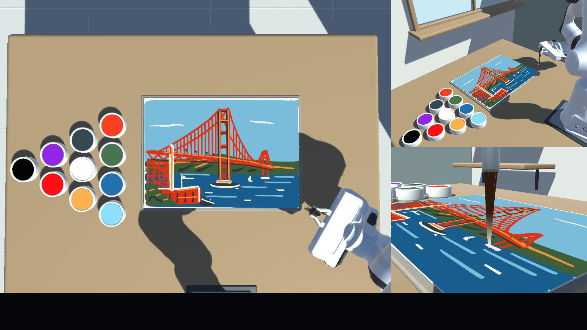

# RoboPaintBench

**Can a language model turn a painting goal into physical brush strokes?**

A robot-painting benchmark and playground built on [AgentArk](https://p90-rushb.github.io/agentark-hub/). Models use camera feedback to control a simulated Panda arm, find paint and paper, and paint through timed 3D movements.

[**Website**](https://robopaintbench.org/) · [**Replay in Colab**](https://colab.research.google.com/github/P90-RushB/robopaint-bench/blob/main/notebooks/GoldenGate_Record_Colab.ipynb) · [**Run locally**](docs/local-setup.md) · [**Paint your own goal**](docs/custom-painting.md) · [**中文**](README.zh-CN.md)



*An actual recording frame: Astra at the end of ICL Round 3. The close-up is for viewers; models receive the two fixed workspace cameras.*

## Three ways to paint

| Mode | What the model receives | What you can do |
| --- | --- | --- |
| **Reference-image painting · Golden Gate Bridge** | A shared photograph and instructions to reproduce it. | Replay the published runs or evaluate a model on the fixed reference. |
| **Text-prompt painting · A pelican riding a bicycle** | A text description, with no reference artwork. Workspace observations remain visual. | Explore how models turn the same written idea into a painting. |
| **Custom painting · Your goal** | Your own prompt, one or several reference images, or both. | Choose a model and let it paint a new subject. |

The two fixed targets each contain **11 models × 3 connected ICL rounds**: 66 saved canvases in total. Each round starts with fresh paper while the same agent retains experience through its context and memory. Model weights stay fixed. Both galleries default to the author's task-specific personal ranking.

The [project website](https://robopaintbench.org/) is for comparing paintings and watching recordings; this repository is for installing, replaying and running the environment.

## Start here

| You want to… | Open |
| --- | --- |
| **Watch a replay online** | [Golden Gate Colab](https://colab.research.google.com/github/P90-RushB/robopaint-bench/blob/main/notebooks/GoldenGate_Record_Colab.ipynb) · [Pelican Colab](https://colab.research.google.com/github/P90-RushB/robopaint-bench/blob/main/notebooks/Pelican_Record_Colab.ipynb) |
| **Run on your own computer** | [Windows / Linux setup and first replay](docs/local-setup.md) |
| **Ask a model to paint something new** | [Custom prompt and reference-image guide](docs/custom-painting.md) · [Custom painting Colab](https://colab.research.google.com/github/P90-RushB/robopaint-bench/blob/main/notebooks/RobotPainting_Colab.ipynb) |
| **Change the simulation settings** | [Environment and configuration guide](docs/environment.md) |

### Online: open Colab and watch

1. Open a replay notebook above and select a **T4 GPU** under **Runtime → Change runtime type**.
2. Choose a model's record, then **Runtime → Run all**.
3. **Open the viewer URL printed in Step 7.** It shows camera observations, actions and interaction history during the replay.

Replay uses saved actions and **requires no model API key**. A new custom painting uses your model-provider credentials. The custom-painting notebook prepares a run first; you explicitly enable inference when ready. See the [Colab guide](docs/colab-record.md), [custom-painting guide](docs/custom-painting.md) and [validation scope](docs/validation.md).

### Local: Windows or Linux

Install a matching packaged Player and RobotPainting task, then choose **replay** or **new model painting**. A local graphics desktop displays the Unity environment window; replay also provides the observation/history viewer in your browser. No Unity Editor or local model weights are needed.

The [local setup guide](docs/local-setup.md) provides separate copyable commands for **Windows PowerShell** and **Linux**, using Python **3.10.0–3.10.12**. The installer downloads the pinned runtime and prints the path settings for your terminal.

## Environment at a glance

| Setting | Fixed benchmark configuration |
| --- | --- |
| Task | AgentArk **Task 107 · RobotPainting**; env **1.0.5**, task **task-v1** |
| Session | **3 connected ICL rounds**, up to **96 environment actions per round**; seed **107** |
| Model observations | Two fixed **960 × 720** workspace cameras, flange pose and action feedback |
| Actions | Up to 32 timed flange waypoints per action; contact between the simulated brush and paper creates marks |
| Painting mechanics | Fixed brush attachment and board; infinite pigment |
| Timing | 120 Hz control, 480 Hz physics, simulation time scale 1 |
| Agent harness | AgentArk's built-in **SimpleAgent** for every model |

For your own experiments, the environment also supports force-based brush gripping, finite pigment with brush drying/redipping, a randomized board and different physics rates. See [configuration](docs/environment.md). Custom targets and changed mechanics are recorded separately from the fixed benchmark.

Codex SDK, OpenRouter and Volcengine Ark are model-access backends within the same SimpleAgent harness. Actual model/reasoning settings and historical exceptions are retained in the [protocol](benchmarks/protocol.md) and result metadata; a common harness does not imply equal inference compute. Submission reward checks saving/completion, not artistic quality.

## One task in AgentArk

RoboPaintBench focuses on **one AgentArk task**. [**AgentArk Hub**](https://p90-rushb.github.io/agentark-hub/) is the broader environment catalog—think **Steam for AI agents**: discover worlds, run tasks and inspect how agents behave. [AgentArk source and Python package](https://github.com/P90-RushB/AgentArk).

## Results, reproducibility and development

- **Results:** [Golden Gate metadata](benchmarks/results/golden_gate.json) · [Pelican results and settings](docs/pelican-results.md) · [personal rankings and optional scoring](docs/scoring.md).
- **Reproduce:** [benchmark protocol](benchmarks/protocol.md) · [version lock](benchmarks/versions.json) · [advanced replay](docs/replay.md) · [limitations](docs/limitations.md).
- **Contribute:** [submit a result](docs/submissions.md) · [issue form](https://github.com/P90-RushB/robopaint-bench/issues/new?template=result-submission.yml).
- **Build the website:** [preview and hosting](docs/hosting.md). All 69 selected website PNGs are included; full process videos stream from Bilibili.

```sh
python -m unittest discover -s tests -v
python -m pip install -r requirements-site.txt
python scripts/build_site.py --output local_save/site-preview-01
```

These development commands do not launch Unity or call a model.

## Attribution and citation

Inspired by [Thijs Simonian's robot-painter demonstration](https://thijs.net/projects/robot-painter). The Golden Gate reference photograph is by Frank Schulenburg, [CC BY-SA 4.0](https://creativecommons.org/licenses/by-sa/4.0/), resized without cropping. [Asset notices](docs/attribution.md) · [CITATION.cff](CITATION.cff).

Code and documentation use Apache-2.0. Runtime/vendor assets and evaluation images retain their separate terms.
